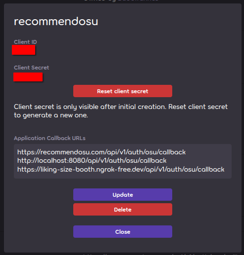
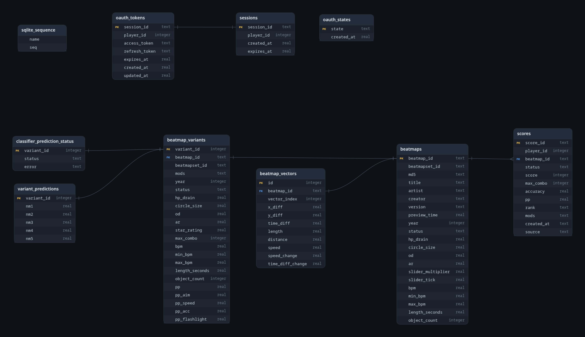

# recommendosu

I will slowly document all of this in my free time. This project is running on my PC at [recommendosu.com](https://recommendosu.com/). 

You can also invite the Discord Bot to your server via this [link](https://discord.com/oauth2/authorize?client_id=1561877569727369296).

I've created a Discord server [here!](https://discord.gg/Dh4TzKGGB7)

This recommender fetches your top/recent plays via your osu! API token,
and compares every ranked and loved map (~151,000) against each top/recent play.
Each map keeps only its best similarity to any of your plays.
Every map is stored as NM plus 19 mod combinations (~3 million variants in total), but your difficulty range and any filters are applied first,
so a typical request scores around 150,000 variants to obtain the top recommendations.
The recommender database (~540MB) is loaded into memory at startup, along with a numpy copy of every variant (and its classifier predictions) for fast filtering, and only newly fetched scores are written back to disk.
I have optimized a typical request down to around 0.5 seconds on the server (not counting the osu! API fetch, see [osu! API usage](#osu-api-usage)).
Number of recommendations are currently uncapped in the deployed website, and even the worst-case query (max_stars = inf, all mod combinations, ~3 million variants) takes around 1.5 seconds on the server. (It took just over 6 seconds in a real browser when the server needed ~3 seconds; I haven't re-measured the browser since.)
The frontend receives the first 1,000 recommendations right away and loads the rest as you scroll. See [PERFORMANCE.md](PERFORMANCE.md) for how this was measured.

I opted with a content similarity approach, as I found that performing user-user/item-item collaborative filtering is difficult due to the time needed to gather per-country user play data.

Credit to [osu!Oracle](https://github.com/token03/osu_oracle) for getting started on this repository's beatmap classifier. 
See [AlphaOSU](https://github.com/AlphaOSU/AlphaOSU), 
[pupsbot](https://github.com/Pupariaa/pupsbot), 
[osu-pps](https://osu-pps.com/#/osu/maps), 
and [Bryan Chan's](https://bryanchan.org/blog/pp-recommender) implementations/deployments for inspiration.

This project was developed on my PC (shown below), and does not require a GPU to recommend maps. 
The GPU was used to train the CNN-XGboost model for classifying maps in tournament categories NM1 to NM5. 
I precomputed the classifier's predictions on the ranked beatmaps from 2007-2026, and inserted them into `/beatmap_recommender/recommender.local.db` (or equivalently `beatmap_recommender/recommender.db`).

```
OS - Fedora 44
IDE - PyCharm, with the miniconda distribution
CPU - AMD Ryzen 7 5700X
GPU - ASUS Prime RTX 5060 Ti 16GB
RAM - Crucial (2 x 32GB) DDR4-3200MHz CL32
```

# Data

The classifier's dataset are tournament maps in [NM1](https://osucollector.com/collections/18935/NM1), 
[NM2](https://osucollector.com/collections/18936/NM2), [NM3](https://osucollector.com/collections/18937/NM3), 
[NM4](https://osucollector.com/collections/18938/NM4), and [NM5](https://osucollector.com/collections/18939/NM5).
Shoutouts to [Specter](https://osu.ppy.sh/users/14551370) for making many tournament collections publicly available.

The recommender's dataset are all ranked and loved beatmaps from 2007-2026, seen from this: [2007-2023](https://osu.ppy.sh/community/forums/topics/330552?n=1), [2024-2026](https://osu.ppy.sh/community/forums/topics/2045828?n=1), [Loved](https://osudl.org/)

I will provide the download link to the .osu files, the classifier database, and the recommender database ([here!](https://drive.google.com/drive/folders/1ieotIJppsimwpRJbcZzQ7oC41nzc7Oz2?usp=sharing)).

# Requirements

Required Python libraries are:

```
fastapi
httpx
matplotlib
numpy
pandas
scikit-learn
osu-tools-py
pydantic
python-dotenv
pytest
Requests
torch
tqdm
optuna
uvicorn[standard]
discord.py
```

# Running the code

The entry points will be listed below:

### OSDB Parser

- `/osdb_parse/osdb_parser.py`: Parses a .osdb file located at `/osdb_parse/inputs`. See the comment at the top of the file to obtain .osdb files. I needed to use this to extract the .osdb files for NM1 to NM5, along with some other tournament formats to play around with.

### Beatmap Classifier

- `/beatmap_classifier/dot_osu_extract/downloader_backoff.py`: Given .txt file of beatmap IDs, downloads .osu files with exponential backoff, via the osu! API v2
- `/beatmap_classifier/classifier_db_setup/osu_parser_modded.py`: Populates `/beatmap_classifier/unexpanded_beatmaps.db` for the CNN-XGBoost model.
- `/beatmap_classifier/train_and_eval.ipynb`: Trains and evaluates the CNN-XGBoost model using a train/val/test split.
- `/beatmap_classifier/train_full.ipynb`: Trains the CNN-XGBoost model on the full dataset.
- `/beatmap_classifier/test_model.py`: Can input beatmap IDs and see the prediction probabilities.
- `/beatmap_classifier/data/extract_osu.py`: Extracts .osu files from directories of .osz archives.

The parser stores every vector channel, including `speed_change` and `time_diff_change`, so training reads them straight from the database. 
Training and prediction divide both `time_diff` and `time_diff_change` by the same saved `max_time_diff` (`vector_normalization.json`), so the two always build identical inputs.

`osu_parser_modded.py` runs `/beatmap_classifier/clean_multicategory_maps.sql` once it's done, which removes maps placed in more than one tournament slot.
You can preview them with `/beatmap_classifier/view_multicategory_maps.sql` in the database browser of your choice (I used DB Browser for SQLite).

### Beatmap Recommender

- `/beatmap_recommender/data/extract_osu.py`: Extracts .osu files from directories of .osz archives.
- `/beatmap_recommender/recommender_db_setup/populate.py`: Populates the recommender database (`beatmap_recommender/dummy.db` by default, see `--db`). We needed a separate population script for the beatmapset ids, and to prevent inserting the CNN vectors.
- `/beatmap_recommender/recommender_db_setup/beatmap_id_resolution.py`: Works out the real beatmap ID of every .osu file before `populate.py` inserts it.
- `/beatmap_recommender/recommender_db_setup/precompute_nm1-5.py`: Populates `beatmap_recommender/recommender.local.db` with the CNN-XGBoost probabilities for each beatmap.
- `/beatmap_recommender/content_similarity/test_recommender.py`: You can run this to see what the recommendations would look like. If you're running this from the CLI, this is the command (`PYTHONPATH=. python beatmap_recommender/content_similarity/test_recommender.py
`)
- `/beatmap_recommender/recommender.py`: The recommender for the backend. You can tweak some of the global variables if desired.
- `/beatmap_recommender/benchmarks/profile_recommender.py` and `/beatmap_recommender/benchmarks/snapshot_recommender.py`: Time/profile the recommender, and check that a change doesn't alter its output. See [PERFORMANCE.md](PERFORMANCE.md).

### Rebuilding the recommender database

You only need this if you want to rebuild the database from the .osu files yourself; the [download link](#data) already includes a finished database.

The scripts expect the .osu files to be laid out as `beatmap_recommender/data/<Ranked|Loved>/<year>/*.osu`, because the beatmap status and year are taken from the folder names. 
The app won't use the result until you copy or rename it to `beatmap_recommender/recommender.local.db` (local) or `beatmap_recommender/recommender.db` (production). 
Run both steps from the project root, in this order:

1. **`populate.py`** creates the tables and inserts every osu!standard beatmap plus its 20 mod variants (NM and 19 mod combinations), with star rating and pp from `VersionAwareOsuCalculator`. This takes a while (~7h30m).

   ```bash
   # Check the ID resolution first. Nothing is written to a database.
   python -m beatmap_recommender.recommender_db_setup.populate --resolve-only --seed-db beatmap_recommender/dummy.db

   # Populate a fresh database
   python -m beatmap_recommender.recommender_db_setup.populate --db beatmap_recommender/fresh.db --seed-db beatmap_recommender/dummy.db

   # No existing database to seed from: every unresolved file goes through the osu! API
   python -m beatmap_recommender.recommender_db_setup.populate --db beatmap_recommender/fresh.db
   ```

   Without `--seed-db`, the ID resolution makes about 22,000 API calls at ~1 per second, which adds roughly 6 hours before the difficulty calculation starts. It needs `OSU_CLIENT_ID` and `OSU_CLIENT_SECRET` in `.env`. 
   Responses are cached in `populate_logs/api_lookup_cache.json`, so if the run is interrupted, running the same command again picks up where the lookups left off. You can also run `--resolve-only` first (without `--seed-db`) to do all the lookups and check the log before committing to the full run.

   Before any difficulty calculation, it works out every file's real beatmap ID. A file's own `BeatmapID` can't be trusted when it's missing (files before format v10), `0`/`-1` (e.g. some guest difficulties), or shared by several different files (e.g. every difficulty copying the Normal's ID). Since `beatmap_id` is the primary key, inserting those as-is would make the files overwrite each other. 
   For those files, and for files missing `ApproachRate` or `BeatmapSetID`, it checks in this order:
   1. `recommender_db_setup/fixed_beatmap_rows.csv`: manually corrected IDs, beatmapset IDs and ARs for maps the API can't find by checksum. These override the file's own ID.
   2. `--seed-db`: the IDs an existing database already resolved for the same file contents (opened read-only). This is optional, but without it a full run makes ~22,000 extra API calls.
   3. The osu! API (`/beatmaps/lookup?checksum=<md5>`), cached in `recommender_db_setup/populate_logs/api_lookup_cache.json` so reruns don't fetch again.

   Files that still can't be resolved are not inserted. Files missing AR that nothing else covers use OD, like osu! does. 
   Each file is inserted in its own transaction savepoint, so one bad file can't roll back the rest of a batch. 
   Every file that needed resolving, was skipped, or failed is listed in `recommender_db_setup/populate_logs/populate_<timestamp>.csv`.

2. **`precompute_nm1-5.py`** runs the CNN-XGBoost classifier on every NM variant and stores the NM1 to NM5 probabilities. It uses the GPU if one is available. 
   It reads and writes `DB_PATH` at the top of the file, so point it at the database you just populated. 
   It reads the model files in `beatmap_classifier/models/full/`, including `vector_normalization.json`, which the training notebook writes so that predictions scale their inputs the same way training did. 
   `SELECTION_MODE` picks what to classify: `"pending"` (not yet classified), `"failed"` (pending plus previous failures), or `"all"` (everything, which is what you want after retraining the model).

### Frontend

This was meant to be run with Docker compose. See the Docker Commands section later.

# Testing

The backend tests use pytest and the frontend tests use Vitest. Both suites live in `/tests` (the frontend ones in `/tests/frontend`).

```
### backend, from the repository root
pip install -r requirements-dev.txt
python -m pytest

### also run the slower tests against the real beatmap_recommender/dummy.db
python -m pytest -m slow

### frontend
cd frontend
npm install
npm test
```

Tests that need files which aren't in the repository (`dummy.db`, the .osu files in `beatmap_recommender/data`, or osu-tools-py) skip themselves when those are missing.

### A note on how the tests were written

The testing in this project was done with massive help from [Claude Code](https://claude.com/claude-code), Anthropic's AI coding assistant. 
I knew the general concepts of software testing but hadn't written many tests myself, 
so Claude Code wrote the backend and frontend test suites, the test configuration, and the comments explaining each testing technique as it's used. 
Writing the tests also turned up real bugs, which were then fixed:

- **The classifier was fed differently scaled inputs than it was trained on.** 
  Training divides each note's time gap by 86,087 and each slider length by 500, but `precompute_nm1-5.py` passed the raw values, so the model saw numbers up to ~86,000 times larger than anything it learned from. 
  The notebook's accuracy couldn't show this, because its test data never goes through `precompute_nm1-5.py`. 
  On one tournament map from each of NM1 to NM5, the old predictions got 2 of 5 categories right (mostly guessing NM1); with the fix, all 5 are right. 
  The scaling constants are now saved next to the model, and `tests/test_classifier_features.py` checks that training and prediction build identical inputs.
- A crash when a player had no matching plays.
- NC scores being dropped instead of counted as DT.
- The frontend's filter labels not being linked to their number boxes in the HTML (so clicking a label didn't select its box, and screen readers couldn't tell the 16 boxes apart).

# osu! API usage

The osu! API asks for [no more than 60 requests per minute](https://osu.ppy.sh/docs/), with some bursting allowed. 
Every user's token is issued to this application, so the backend treats that as one budget shared by all users:

- **One rate limiter for the whole process** (`RateLimiter` in `beatmap_recommender/api/osu_api_client.py`): up to 4 requests at once (`REQUEST_BURST`), then one every ~1.07s, so no 60 second window holds more than 60 requests (`REQUESTS_PER_MINUTE`). 
  Every `OsuAPIClient` uses it, including the database setup scripts.
- **A score refresh is 4 requests** (top and recent plays, 2 pages of 100 each). The top and recent lists are fetched at the same time, so a refresh takes about one round trip per page instead of 4 round trips plus ~3.3s of spacing (~0.6s instead of ~4.5s with 300ms per request).
- **Recent refreshes are skipped.** If a player's scores were refreshed successfully in the last 2 minutes (`SCORE_REFRESH_INTERVAL` in `score_collector.py`), the next recommendation reuses them, e.g. when someone changes a setting and re-runs. 
  A map played during those 2 minutes isn't excluded until the next refresh.

The rate limiter and the refresh times live in the backend's memory, which works because production runs a single uvicorn process. 
With several workers or replicas, each would get its own 60 per minute, and this state would have to move somewhere shared (e.g. Redis).

# Logging

The backend logs through Python's `logging` module. Set `LOG_LEVEL` (default `INFO`) to change how much is logged; `LOG_LEVEL=DEBUG` adds the full recommendation config and the top 10 results of each request.

In production (`compose.production.yml`), the logs (including uvicorn's startup messages and one line per request) are also written to `logs/backend.log` in the repository folder. The local stack only logs to stdout (`docker compose logs`). 
The file rotates at 10MB and keeps 5 old files (`backend.log.1` to `backend.log.5`). Outside compose, set `LOG_FILE` to a path to get the same file.

# Docker Commands

Some Docker commands to get you started...

### Local

```
### everything
HOST_UID=$(id -u) HOST_GID=$(id -g) docker compose -p recommendosu-local -f compose.yml -f compose.local.yml up --build -d

### rebuild/recreate nginx first
HOST_UID=$(id -u) HOST_GID=$(id -g) docker compose -p recommendosu-local -f compose.yml -f compose.local.yml build nginx && \
HOST_UID=$(id -u) HOST_GID=$(id -g) docker compose -p recommendosu-local -f compose.yml -f compose.local.yml up -d --no-deps nginx

### rebuild/recreate frontend and backend without touching nginx
HOST_UID=$(id -u) HOST_GID=$(id -g) docker compose -p recommendosu-local -f compose.yml -f compose.local.yml build frontend backend && \
HOST_UID=$(id -u) HOST_GID=$(id -g) docker compose -p recommendosu-local -f compose.yml -f compose.local.yml up -d --no-deps frontend backend

### soft shutdown and restart to test nginx-only page
docker compose -p recommendosu-local -f compose.yml -f compose.local.yml stop frontend backend
docker compose -p recommendosu-local -f compose.yml -f compose.local.yml start frontend backend

### logs
docker compose -p recommendosu-local -f compose.yml -f compose.local.yml logs -f

### full shutdown
docker compose -p recommendosu-local -f compose.yml -f compose.local.yml down
```

### Production and Discord bot

The Discord bot (`bot/`) is behind the `bot` compose profile, so commands without `--profile bot` leave it alone. It talks to the backend over the compose network, so it must run in the same project as the website (`-p recommendosu-prod`). Without `-p`, Compose starts a separate project with a second backend.

It needs `DISCORD_TOKEN` and `BOT_API_KEY` in `.env` (see `.env.example`); the backend reads `BOT_API_KEY` too, so restart the backend after setting it. Set `BOT_DEV_GUILD_ID` to a server ID to update the commands there instantly instead of within about an hour. `/link` data is kept in `bot/data/`.

Don't run it from the local stack with the production token: two bots logged in with one token both answer every command.

```
### everything, website and bot
docker compose -p recommendosu-prod -f compose.yml -f compose.production.yml --profile bot up --build -d

### website only, without touching the bot
docker compose -p recommendosu-prod -f compose.yml -f compose.production.yml up --build -d

### rebuild/recreate nginx first
docker compose -p recommendosu-prod -f compose.yml -f compose.production.yml build nginx && \
docker compose -p recommendosu-prod -f compose.yml -f compose.production.yml up -d --no-deps nginx

### rebuild/recreate frontend and backend without touching nginx
docker compose -p recommendosu-prod -f compose.yml -f compose.production.yml build frontend backend && \
docker compose -p recommendosu-prod -f compose.yml -f compose.production.yml up -d --no-deps frontend backend

### start or rebuild the bot, without touching the website
docker compose -p recommendosu-prod -f compose.yml -f compose.production.yml --profile bot build bot && \
docker compose -p recommendosu-prod -f compose.yml -f compose.production.yml --profile bot up -d --no-deps bot

### rebuild/recreate the backend and the bot (after changing the bot endpoints in main.py)
docker compose -p recommendosu-prod -f compose.yml -f compose.production.yml --profile bot build backend bot && \
docker compose -p recommendosu-prod -f compose.yml -f compose.production.yml --profile bot up -d --no-deps backend bot

### soft shutdown and restart to test nginx-only page
docker compose -p recommendosu-prod -f compose.yml -f compose.production.yml stop frontend backend
docker compose -p recommendosu-prod -f compose.yml -f compose.production.yml start frontend backend

### stop and start the bot only
docker compose -p recommendosu-prod -f compose.yml -f compose.production.yml --profile bot stop bot
docker compose -p recommendosu-prod -f compose.yml -f compose.production.yml --profile bot start bot

### frontend, backend, and nginx logs
docker compose -p recommendosu-prod -f compose.yml -f compose.production.yml logs -f

### frontend, backend, nginx, and Discord bot logs
docker compose -p recommendosu-prod -f compose.yml -f compose.production.yml --profile bot logs -f

### only Discord bot logs
docker compose -p recommendosu-prod -f compose.yml -f compose.production.yml --profile bot logs -f bot

### full shutdown, website only
docker compose -p recommendosu-prod -f compose.yml -f compose.production.yml down

### full shutdown, website and bot
docker compose -p recommendosu-prod -f compose.yml -f compose.production.yml --profile bot down
```

### Clearing Cache

```
docker builder du
docker builder prune -a
docker builder du
docker system df
```

# Tips

If you're messing around with the codebase and the login doesn't work, check if `OSU_REDIRECT_URI` in `.env.local` or `.env.production` are really in your OAuth Application:



The database schema, generated by [SQLite to ER Diagram](https://sqltoerdiagram.com/sqlite/), looks like this:


