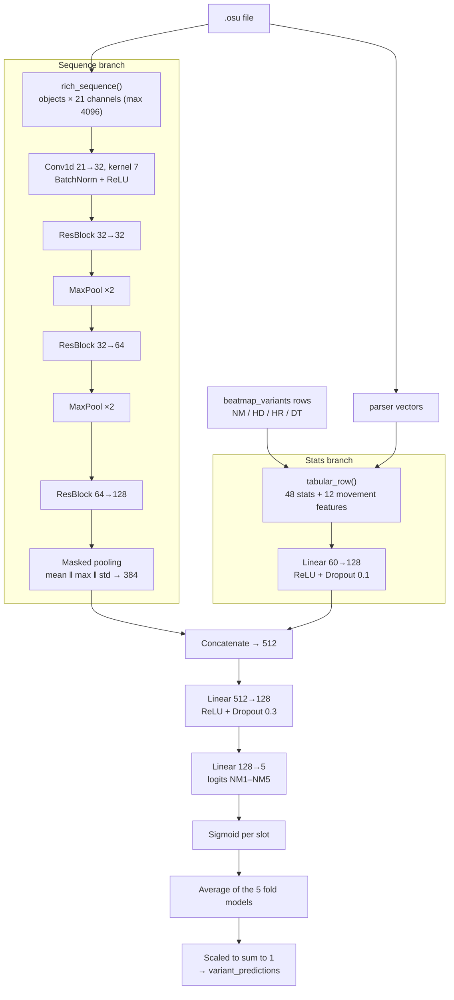
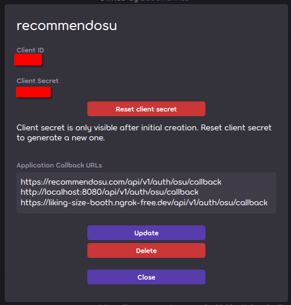
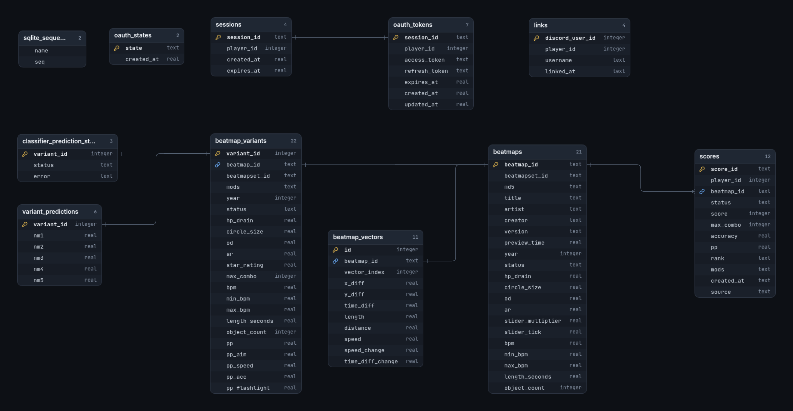
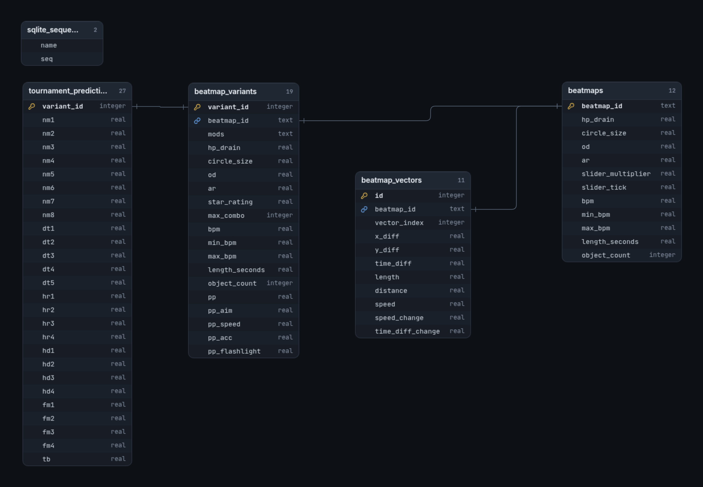

# recommendosu

This document is not complete. I add to it when I have time. The project runs on my PC at [recommendosu.com](https://recommendosu.com/).

To add the Discord bot to your server, use this [link](https://discord.com/oauth2/authorize?client_id=1561877569727369296).

The project has a Discord server. To join it, use this [link](https://discord.gg/Dh4TzKGGB7).

The recommender gets your top plays and recent plays with your osu! API token.
It compares each ranked map and loved map (approximately 151,000) with each of these plays.
Each map keeps only its highest similarity to one of your plays.

The database stores each map as NM plus 19 mod combinations. This is approximately 3 million variants in total.
The recommender applies your difficulty range and your filters first.
Thus, a typical request scores approximately 150,000 variants to find the best recommendations.

When the server starts, it reads each variant and its classifier predictions into numpy arrays. These arrays make the filters fast.
The server reads all other data, and writes all new scores, directly in the SQLite file.

On the server, a typical request takes approximately 0.5 seconds.
This time does not include the requests to the osu! API (refer to [osu! API usage](#osu-api-usage)).

The website has no limit on the number of recommendations.
The worst-case request uses max_stars = inf and all mod combinations, which is approximately 3 million variants.
On the server, this request takes approximately 1.5 seconds.
In an earlier measurement, the server took approximately 3 seconds, and a real browser took a little more than 6 seconds.
I did not measure the browser again after that.

The frontend gets the first 1,000 recommendations immediately. It gets the remaining recommendations when you scroll.
For the measurement procedure, refer to [PERFORMANCE.md](PERFORMANCE.md).

The recommender uses content similarity.
I did not use user-user or item-item collaborative filtering.
Collaborative filtering needs play data from many users in each country, and it takes too much time to collect this data.

[osu!Oracle](https://github.com/token03/osu_oracle) gave the start for the beatmap classifier of this repository.
These projects gave ideas for this project:
[AlphaOSU](https://github.com/AlphaOSU/AlphaOSU),
[pupsbot](https://github.com/Pupariaa/pupsbot),
[osu-pps](https://osu-pps.com/#/osu/maps),
and the recommender of [Bryan Chan](https://bryanchan.org/blog/pp-recommender).

I developed this project on my PC (specifications below).
The recommender does not need a GPU.
I used the GPU only to train the classifier. The classifier sorts maps into the tournament categories NM1 to NM5.
I calculated the classifier predictions for the ranked beatmaps from 2007 to 2026 before deployment.
The predictions are in `/beatmap_recommender/recommender.local.db`. The file `beatmap_recommender/recommender.db` has the same data.

```
OS - Fedora 44
IDE - PyCharm, with the miniconda distribution
CPU - AMD Ryzen 7 5700X
GPU - ASUS Prime RTX 5060 Ti 16GB
RAM - Crucial (2 x 32GB) DDR4-3200MHz CL32
```

# Data

The dataset of the classifier are tournament maps from these [collections](https://osucollector.com/users/18473778/uploads/collections), previously used [this](https://osucollector.com/users/14551370/uploads/collections)


Thank you to [Specter](https://osu.ppy.sh/users/14551370) and [
Mai-Sakurajima](https://osu.ppy.sh/users/18473778), who made many tournament collections public.

The dataset of the recommender is all ranked and loved beatmaps from 2007 to 2026. The main source is [osu!dl](https://osudl.org/). Alternate sources are from the forum posts [2007-2023](https://osu.ppy.sh/community/forums/topics/330552?n=1), and [2024-2026](https://osu.ppy.sh/community/forums/topics/2045828?n=1).

The .osu files, the classifier database, and the recommender database are available at this [download link](https://drive.google.com/drive/folders/1ieotIJppsimwpRJbcZzQ7oC41nzc7Oz2?usp=sharing).

# Requirements

The code needs these Python libraries:

```
fastapi
httpx
numpy
pandas
scikit-learn
osu-tools-py
pydantic
python-dotenv
pytest
Requests
torch
tqdm
uvicorn[standard]
discord.py
```

# Running the code

This section lists the entry points.

### OSDB Parser

- `/osdb_parse/osdb_parser.py`: Parses a .osdb file in `/osdb_parse/inputs`. To get .osdb files, read the comment at the top of the file. I used this script to get the .osdb files for NM1 to NM5 and for some other tournament formats.

### Beatmap Classifier

- `/beatmap_classifier/dot_osu_extract/downloader_backoff.py`: Downloads the .osu files of the beatmap IDs in a .txt file from osu.direct. If a download fails, the script waits for an exponentially longer time before it tries again.
  - Give it a .txt file, or a folder to download all of its .txt files.
  - Each list goes to a subfolder of `outputs/` with the name of its list folder: `tournament/NM1.txt` goes to `outputs/tournament/NM1/`, `general/aim.txt` to `outputs/general/aim/`, and `expanded_collection/NM1.txt` to `outputs/expanded_collection/NM1/`. Thus, lists from different folders do not share an output folder.
- `/beatmap_classifier/classifier_db_setup/populate.py`: Fills a classifier database from the .osu files in `/beatmap_classifier/data/<SLOT>/`. The default database is `/beatmap_classifier/expanded_collection.db`. The options are `--db`, `--data-dir`, and `--keep-multicategory`. Use `--keep-multicategory` to keep maps that are in more than one slot; `train_fusion.py` needs them. The command is `PYTHONPATH=. python beatmap_classifier/classifier_db_setup/populate.py --keep-multicategory`.
- `/beatmap_classifier/dot_osu_extract/osucollector_scraper.py`: Gets the tournament-slot collections from osu!collector. It sorts their beatmap IDs into one list for each slot, in `dot_osu_extract/expanded_collection/<SLOT>.txt`. These maps are the training data of the current model.
  - It keeps the collection JSON and a manifest (slot, skill, beatmapset ID and checksum of each map) in `dot_osu_extract/outputs/expanded_collection_cache/`.
  - To download the .osu files, use `downloader_backoff.py expanded_collection`. To make a classifier database from them, use `populate.py --data-dir dot_osu_extract/outputs/expanded_collection`.
- `/beatmap_classifier/train_fusion.py`: Trains the fusion classifier that the website uses, and saves it in `/beatmap_classifier/models/fusion/`. The command is `python -m beatmap_classifier.train_fusion`. By default it reads `expanded_collection.db` and `data/`; `--db` and `--osu-dir` select others.
  - One network reads the hit objects of each map from the .osu file (21 channels for each object). It also reads the NM/HD/HR/DT stats and the movement features of the map.
  - The network gives a different probability to each of NM1 to NM5, because a map can be in more than one slot.
  - The training keeps an exponential moving average of the weights.
  - The training makes one model for each fold. The folds keep all difficulties of a beatmapset together. The prediction is the average of the 5 models.
- `/beatmap_classifier/test_model.py`: Shows the prediction probabilities for the beatmap IDs that you type.
- `/beatmap_classifier/classifier/inference.py`: Runs the trained model on one beatmap. `test_model.py` and `precompute_nm1-5.py` use it.
  - `/beatmap_classifier/classifier/fusion.py` contains the model: the input parser, the network, and the training.
  - `/beatmap_classifier/classifier/training_data.py` loads a classifier database for `train_fusion.py`.

#### The fusion network



Each ResBlock has two kernel-5 convolutions with BatchNorm, ReLU, dropout 0.1, and a skip connection.
A mask keeps the padding out of each layer and out of the pooling.
The network has approximately 254,000 parameters.

The training uses these items:

- A binary cross-entropy for each slot, because a map can be in more than one slot.
- Random horizontal flips and vertical flips of the maps.
- An exponential moving average of the weights (decay 0.999). The training validates and saves this average.

The parser stores all vector channels, including `speed_change` and `time_diff_change`. Thus, the training reads them directly from the database.
The training and the prediction divide `time_diff` and `time_diff_change` by the same `max_time_diff`.
This value is in `models/fusion/fusion_config.json`. Thus, the training and the prediction always make the same inputs.
`tests/test_classifier_features.py` makes sure that the inputs are the same.

When `populate.py` is complete, it runs `/beatmap_classifier/clean_multicategory_maps.sql`.
This script removes the maps that are in more than one tournament slot.
The option `--keep-multicategory` stops this step.
To see these maps before they are removed, run `/beatmap_classifier/view_multicategory_maps.sql` in a database browser. I used DB Browser for SQLite.

### Beatmap Recommender

- `/beatmap_recommender/data/extract_osu.py`: Extracts the .osu files from directories of .osz archives.
- `/beatmap_recommender/recommender_db_setup/populate.py`: Fills the recommender database. The default database is `beatmap_recommender/dummy.db` (refer to `--db`). This is a different script from the classifier script, because the recommender needs the beatmapset IDs and does not need the CNN vectors.
- `/beatmap_recommender/recommender_db_setup/beatmap_id_resolution.py`: Finds the real beatmap ID of each .osu file before `populate.py` inserts it.
- `/beatmap_recommender/recommender_db_setup/precompute_nm1-5.py`: Stores the NM1-NM5 probabilities of the fusion classifier for each NM variant in the recommender database. The default database is `beatmap_recommender/dummy.db` (refer to `DB_PATH` at the top of the file).
- `/beatmap_recommender/content_similarity/test_recommender.py`: Shows examples of recommendations. To run it from the CLI, use this command: `PYTHONPATH=. python beatmap_recommender/content_similarity/test_recommender.py`
- `/beatmap_recommender/changelog.json`: The changelog that the website shows at `/changelog` and that the bot shows with `/changelog`. The newest entry is first. Each entry has this format: `{"date": "2026-11-01", "title": "...", "changes": ["...", "..."]}`.
  - The backend reads this file at each request. Thus, on the server, a change shows immediately, and a restart is not necessary.
  - This is possible because `beatmap_recommender/` is mounted in the backend container.
- `/beatmap_recommender/recommender.py`: The recommender of the backend. You can change some of its global variables.
- `/beatmap_recommender/benchmarks/profile_recommender.py` and `/beatmap_recommender/benchmarks/snapshot_recommender.py`: Measure the time of the recommender, and make sure that a change does not change its output. Refer to [PERFORMANCE.md](PERFORMANCE.md).

### Rebuilding the recommender database

Do this procedure only if you want to make the database again from the .osu files.
The [download link](#data) includes a complete database.

The scripts read the .osu files from `beatmap_recommender/data/<Ranked|Loved>/<year>/*.osu`.
The scripts get the beatmap status and the year from the folder names.

The application does not use the new database until you copy or rename it:

- For a local run, use `beatmap_recommender/recommender.local.db`.
- For production, use `beatmap_recommender/recommender.db`.

Do the two steps from the project root, in this sequence:

1. **`populate.py`** makes the tables. It inserts each osu!standard beatmap and its 20 mod variants (NM and 19 mod combinations).
   It calculates the star rating and the pp with `VersionAwareOsuCalculator`. This step takes approximately 7 hours 30 minutes.

   ```bash
   # Check the ID resolution first. Nothing is written to a database.
   python -m beatmap_recommender.recommender_db_setup.populate --resolve-only --seed-db beatmap_recommender/dummy.db

   # Populate a fresh database
   python -m beatmap_recommender.recommender_db_setup.populate --db beatmap_recommender/fresh.db --seed-db beatmap_recommender/dummy.db

   # No existing database to seed from: every unresolved file goes through the osu! API
   python -m beatmap_recommender.recommender_db_setup.populate --db beatmap_recommender/fresh.db
   ```

   Without `--seed-db`, the ID resolution sends approximately 22,000 API requests at approximately 1 request each second.
   This adds approximately 6 hours before the difficulty calculation starts.
   The API requests need `OSU_CLIENT_ID` and `OSU_CLIENT_SECRET` in `.env`.

   The script keeps the API responses in `populate_logs/api_lookup_cache.json`.
   If the run stops, run the same command again. The script continues from the last request.
   You can also run `--resolve-only` first, without `--seed-db`. This sends all the requests. Then, examine the log before you start the full run.

   Before the difficulty calculation, the script finds the real beatmap ID of each file.
   The `BeatmapID` in the file is not always correct:
   - Files before format v10 do not have it.
   - Some files have `0` or `-1`, for example some guest difficulties.
   - Some different files have the same ID, for example when each difficulty copies the ID of the Normal difficulty.

   `beatmap_id` is the primary key. If the script inserted these IDs without a change, the files would overwrite each other.
   For these files, and for files without `ApproachRate` or `BeatmapSetID`, the script uses these sources in this sequence:
   1. `recommender_db_setup/fixed_beatmap_rows.csv`: IDs, beatmapset IDs, and ARs that I corrected manually. These are for maps that the API cannot find by checksum. These values replace the ID in the file.
   2. `--seed-db`: the IDs that an existing database found for the same file contents. The script opens this database read-only. This source is optional, but without it a full run sends approximately 22,000 more API requests.
   3. The osu! API (`/beatmaps/lookup?checksum=<md5>`). The script keeps the responses in `recommender_db_setup/populate_logs/api_lookup_cache.json`, so a second run does not send the requests again.

   The script does not insert files that it cannot resolve.
   If no source gives the AR of a file, the script uses the OD, as osu! does.
   The script inserts each file in its own transaction savepoint. Thus, one bad file cannot roll back the other files of a batch.
   The file `recommender_db_setup/populate_logs/populate_<timestamp>.csv` lists each file that needed resolution, that the script skipped, or that failed.

2. **`precompute_nm1-5.py`** runs the fusion classifier on each NM variant. It stores the NM1 to NM5 probabilities.
   Each value is the probability of the slot, scaled so that the five values add up to 1.
   The script uses the GPU if a GPU is available.
   - The script reads and writes the database in `DB_PATH` at the top of the file. Set it to the database that you filled in step 1.
   - The script reads the model files in `beatmap_classifier/models/fusion/`. `train_fusion.py` writes these files.
   - The script also reads the NM/HD/HR/DT `beatmap_variants` rows of each map.
   - `SELECTION_MODE` selects the variants to classify:
     - `"pending"`: the variants that are not classified.
     - `"failed"`: the pending variants and the variants that failed before.
     - `"all"`: all variants. Use this value after you train the model again.

### Frontend

Use Docker Compose to run the frontend. Refer to the section Docker Commands.

# Testing

The backend tests use pytest. The frontend tests use Vitest.
The two test suites are in `/tests`. The frontend tests are in `/tests/frontend`.

```
### backend, from the repository root
pip install -r requirements-dev.txt
python -m pytest

### also run the slower tests against the real beatmap_recommender/dummy.db
python -m pytest -m slow

### frontend
cd frontend
npm install
npm test
```

Some tests need files that are not in the repository: `dummy.db`, the .osu files in `beatmap_recommender/data`, or osu-tools-py.
If these files are not available, these tests do not run.

### A note on how the tests were written

[Claude Code](https://claude.com/claude-code), the AI coding assistant of Anthropic, gave much help with the tests of this project.
I knew the general concepts of software tests, but I had not written many tests.
Claude Code wrote these items:

- The backend test suite and the frontend test suite.
- The test configuration.
- The comments that explain each test technique where the tests use it.

# osu! API usage

The osu! API asks for [a maximum of 60 requests each minute](https://osu.ppy.sh/docs/). It permits some short bursts.
The API issues each user token to this application. Thus, the backend uses one request limit for all users together:

- **One rate limiter for the full process** (`RateLimiter` in `beatmap_recommender/api/osu_api_client.py`).
  - It sends a maximum of 4 requests at the same time (`REQUEST_BURST`). After that, it sends one request each 1.07 seconds (approximately).
  - Thus, a 60-second period never has more than 60 requests (`REQUESTS_PER_MINUTE`).
  - All `OsuAPIClient` objects use it, including the database setup scripts.
- **A score refresh is 4 requests.** These are 2 pages of 100 top plays and 2 pages of 100 recent plays.
  - The backend gets the top list and the recent list at the same time.
  - Thus, a refresh takes approximately one round trip for each page, not 4 round trips and 3.3 seconds of interval.
  - With 300 ms for each request, this is approximately 0.6 seconds, not 4.5 seconds.
- **The backend does not refresh scores that are new.**
  - If the scores of a player had a successful refresh in the last 2 minutes, the next recommendation uses them again. The interval is `SCORE_REFRESH_INTERVAL` in `score_collector.py`.
  - For example, this occurs when a player changes a setting and starts the recommendation again.
  - The recommendations include a map that the player played in these 2 minutes, until the next refresh.

The rate limiter and the refresh times are in the memory of the backend.
This is satisfactory because production runs only one uvicorn process.
With more workers or replicas, each one gets its own limit of 60 requests each minute.
Then, this data must move to a shared location, for example Redis.

# Logging

The backend writes its logs with the Python `logging` module.
To change the quantity of log messages, set `LOG_LEVEL`. The default value is `INFO`.
`LOG_LEVEL=DEBUG` also writes the full recommendation configuration and the 10 best results of each request.

In production (`compose.production.yml`), the backend also writes the logs to `logs/backend.log` in the repository folder.
These logs include the startup messages of uvicorn and one line for each request.
The local stack writes the logs only to stdout (`docker compose logs`).

When the file is 10 MB, the backend starts a new file. It keeps 5 old files (`backend.log.1` to `backend.log.5`).
To get the same file outside Docker Compose, set `LOG_FILE` to a path.

# Docker Commands

This section gives some Docker commands.

### Local and dev Discord bot

The local stack also runs a dev Discord bot. This bot is a second Discord application. It is different from the deployed bot:

- It has its own token.
- Its commands are only in your test server.
- Its `/link` data is in `bot/data-dev/`.
- It sends requests to the local backend.

To set up the dev bot, do these steps:

1. In the [Discord developer portal](https://discord.com/developers/applications), make a new application (for example, "recommendosu dev"). Copy its token from Bot -> Reset Token.
2. Add the bot to your test server. Use OAuth2 -> URL Generator, with the scopes `bot` and `applications.commands`.
3. In `.env`, set `DEV_DISCORD_TOKEN` to the token of the bot.
4. In `.env`, set `DEV_BOT_GUILD_ID` to the ID of the test server. To get the ID, turn on Developer Mode, right-click the server, and select Copy Server ID. The commands in this server update immediately.

If `DEV_DISCORD_TOKEN` is not set, all other services start. The dev bot cannot log in, and it stops.
The links of the dev bot go to the live website. These links are the "full list at recommendosu.com" footer and the link of `/changelog`.

```
### everything, website and dev bot
HOST_UID=$(id -u) HOST_GID=$(id -g) docker compose -p recommendosu-local -f compose.yml -f compose.local.yml --profile bot up --build -d

### rebuild/recreate nginx first
HOST_UID=$(id -u) HOST_GID=$(id -g) docker compose -p recommendosu-local -f compose.yml -f compose.local.yml build nginx && \
HOST_UID=$(id -u) HOST_GID=$(id -g) docker compose -p recommendosu-local -f compose.yml -f compose.local.yml up -d --no-deps nginx

### rebuild/recreate frontend and backend without touching nginx
HOST_UID=$(id -u) HOST_GID=$(id -g) docker compose -p recommendosu-local -f compose.yml -f compose.local.yml build frontend backend && \
HOST_UID=$(id -u) HOST_GID=$(id -g) docker compose -p recommendosu-local -f compose.yml -f compose.local.yml up -d --no-deps frontend backend

### start or rebuild only the dev bot, without touching the website
HOST_UID=$(id -u) HOST_GID=$(id -g) docker compose -p recommendosu-local -f compose.yml -f compose.local.yml --profile bot up --build -d --no-deps bot

### soft shutdown and restart to test nginx-only page
docker compose -p recommendosu-local -f compose.yml -f compose.local.yml stop frontend backend
docker compose -p recommendosu-local -f compose.yml -f compose.local.yml start frontend backend

### logs (add bot, backend, ... at the end for one service)
docker compose -p recommendosu-local -f compose.yml -f compose.local.yml --profile bot logs -f

### full shutdown, website and dev bot
docker compose -p recommendosu-local -f compose.yml -f compose.local.yml --profile bot down
```

### Production and Discord bot

The Discord bot (`bot/`) is in the `bot` compose profile. Commands without `--profile bot` do not change the bot.

The bot sends requests to the backend through the compose network. Thus, it must run in the same project as the website (`-p recommendosu-prod`).
Without `-p`, Compose starts a different project with a second backend.

The bot needs `DISCORD_TOKEN` and `BOT_API_KEY` in `.env` (refer to `.env.example`).
The backend also reads `BOT_API_KEY`. Thus, restart the backend after you set it.

The commands of the bot are registered in each server that has the bot.
A change to the commands can take approximately one hour to show.
The `/link` data is in `bot/data/`.

The local stack never uses `DISCORD_TOKEN`. Its bot logs in with `DEV_DISCORD_TOKEN` (refer to Local and dev Discord bot).
If two bots log in with the same token, both bots reply to each command.

```
### everything, website and bot
docker compose -p recommendosu-prod -f compose.yml -f compose.production.yml --profile bot up --build -d

### website only, without touching the bot
docker compose -p recommendosu-prod -f compose.yml -f compose.production.yml up --build -d

### rebuild/recreate nginx first
docker compose -p recommendosu-prod -f compose.yml -f compose.production.yml build nginx && \
docker compose -p recommendosu-prod -f compose.yml -f compose.production.yml up -d --no-deps nginx

### rebuild/recreate frontend and backend without touching nginx
docker compose -p recommendosu-prod -f compose.yml -f compose.production.yml build frontend backend && \
docker compose -p recommendosu-prod -f compose.yml -f compose.production.yml up -d --no-deps frontend backend

### start or rebuild the bot, without touching the website
docker compose -p recommendosu-prod -f compose.yml -f compose.production.yml --profile bot build bot && \
docker compose -p recommendosu-prod -f compose.yml -f compose.production.yml --profile bot up -d --no-deps bot

### rebuild/recreate the backend and the bot (after changing the bot endpoints in main.py)
docker compose -p recommendosu-prod -f compose.yml -f compose.production.yml --profile bot build backend bot && \
docker compose -p recommendosu-prod -f compose.yml -f compose.production.yml --profile bot up -d --no-deps backend bot

### soft shutdown and restart to test nginx-only page
docker compose -p recommendosu-prod -f compose.yml -f compose.production.yml stop frontend backend
docker compose -p recommendosu-prod -f compose.yml -f compose.production.yml start frontend backend

### stop and start the bot only
docker compose -p recommendosu-prod -f compose.yml -f compose.production.yml --profile bot stop bot
docker compose -p recommendosu-prod -f compose.yml -f compose.production.yml --profile bot start bot

### frontend, backend, and nginx logs
docker compose -p recommendosu-prod -f compose.yml -f compose.production.yml logs -f

### frontend, backend, nginx, and Discord bot logs
docker compose -p recommendosu-prod -f compose.yml -f compose.production.yml --profile bot logs -f

### only Discord bot logs
docker compose -p recommendosu-prod -f compose.yml -f compose.production.yml --profile bot logs -f bot

### full shutdown, website only
docker compose -p recommendosu-prod -f compose.yml -f compose.production.yml down

### full shutdown, website and bot
docker compose -p recommendosu-prod -f compose.yml -f compose.production.yml --profile bot down
```

### Clearing Cache

```
docker builder du
docker builder prune -a
docker builder du
docker system df
```

# Tips

If you change the code and the login does not work, examine `OSU_REDIRECT_URI` in `.env.local` or `.env.production`.
Make sure that this value is also in your OAuth application:



[SQLite to ER Diagram](https://sqltoerdiagram.com/sqlite/) made the following diagrams.

This is the recommender + auth + bot database schema.



This is the classifier database schema.

