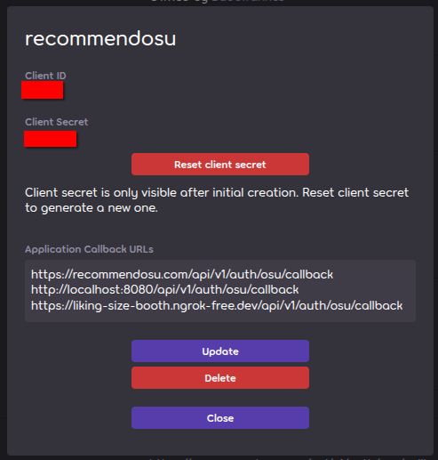
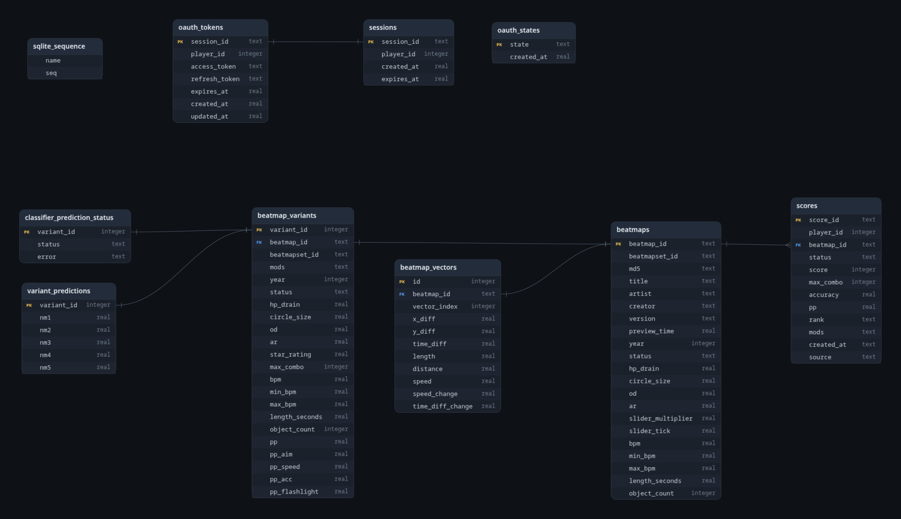

# recommendosu

I will slowly document all of this in my free time. This project is running on my PC at [recommendosu.com](https://recommendosu.com/).

I've created a Discord server [here!](https://discord.gg/Dh4TzKGGB7)

This recommender fetches your top/recent plays via your osu! API token, 
and compares every ranked and loved map (~151,000) against each top/recent play. 
Each map keeps only its best similarity to any of your plays. 
Every map is stored as NM plus 19 mod combinations (~3 million variants in total), but your difficulty range and any filters are applied in SQL first, 
so a typical request scores around 150,000 variants to obtain the top recommendations. 
The recommender database (~540MB) is loaded into memory at startup, and only newly fetched scores are written back to disk. 
I have optimized this down to around 2-3 seconds for outputting the top 100,000 recommendations to the frontend (not counting the osu! API fetch). 
Number of recommendations are currently uncapped in the deployed website, but expect the worst-case query (max_stars = inf, all mod combinations) to take around 1 minute to complete.

I opted with a content similarity approach, as I found that performing user-user/item-item collaborative filtering is difficult due to the time needed to gather per-country user play data.

Credit to [osu!Oracle](https://github.com/token03/osu_oracle) for getting started on this repository's beatmap classifier. 
See [AlphaOSU](https://github.com/AlphaOSU/AlphaOSU), 
[pupsbot](https://github.com/Pupariaa/pupsbot), 
[osu-pps](https://osu-pps.com/#/osu/maps), 
and [Bryan Chan's](https://bryanchan.org/blog/pp-recommender) implementations/deployments for inspiration.

This project was developed on my PC (shown below), and does not require a GPU to recommend maps. 
The GPU was used to train the CNN-XGboost model for classifying maps in tournament categories NM1 to NM5. 
I precomputed the classifier's predictions on the ranked beatmaps from 2007-2026, and inserted them into `/beatmap_recommender/recommender.local.db` (or equivalently `beatmap_recommender/recommender.db`).

```
OS - Fedora 44
IDE - PyCharm, with the miniconda distribution
CPU - AMD Ryzen 7 5700X
GPU - ASUS Prime RTX 5060 Ti 16GB
RAM - Crucial (2 x 32GB) DDR4-3200MHz CL32
```

# Data

The classifier's dataset are tournament maps in [NM1](https://osucollector.com/collections/18935/NM1), 
[NM2](https://osucollector.com/collections/18936/NM2), [NM3](https://osucollector.com/collections/18937/NM3), 
[NM4](https://osucollector.com/collections/18938/NM4), and [NM5](https://osucollector.com/collections/18939/NM5).
Shoutouts to [Specter](https://osu.ppy.sh/users/14551370) for making many tournament collections publicly available.

The recommender's dataset are all ranked and loved beatmaps from 2007-2026, seen from this: [2007-2023](https://osu.ppy.sh/community/forums/topics/330552?n=1), [2024-2026](https://osu.ppy.sh/community/forums/topics/2045828?n=1), [Loved](https://osudl.org/)

I will provide the download link to the .osu files, the classifier database, and the recommender database ([here!](https://drive.google.com/drive/folders/1ieotIJppsimwpRJbcZzQ7oC41nzc7Oz2?usp=sharing)).

# Requirements

Required Python libraries are:

```
fastapi
httpx
matplotlib
numpy
pandas
scikit-learn
osu-tools-py
pydantic
python-dotenv
pytest
Requests
torch
tqdm
optuna
uvicorn[standard]
```

# Running the code

The entry points will be listed below:

### OSDB Parser

- `/osdb_parse/osdb_parser.py`: Parses a .osdb file located at `/osdb_parse/inputs`. See the comment at the top of the file to obtain .osdb files. I needed to use this to extract the .osdb files for NM1 to NM5, along with some other tournament formats to play around with.

### Beatmap Classifier

- `/beatmap_classifier/dot_osu_extract/downloader_backoff.py`: Given .txt file of beatmap IDs, downloads .osu files with exponential backoff, via the osu! API v2
- `/beatmap_classifier/classifier_db_setup/osu_parser_modded.py`: Populates `/beatmap_classifier/beatmaps.db` for the CNN-XGBoost model.
- `/beatmap_classifier/train_and_eval.ipynb`: Trains and evaluates the CNN-XGBoost model using a train/val/test split.
- `/beatmap_classifier/train_full.ipynb`: Trains the CNN-XGBoost model on the full dataset.
- `/beatmap_classifier/test_model.py`: Can input beatmap IDs and see the prediction probabilities.
- `/beatmap_classifier/data/extract_osu.py`: Extracts .osu files from directories of .osz archives.

If you do populate `/beatmap_classifier/beatmaps.db` by yourself, 
please run `/beatmap_classifer/view_multicategory_maps.sql` and `/beatmap_classifier/clean_multicategory_maps.sql` in the database browser of your choice.
I used DB Browser for SQLite while making this project.

### Beatmap Recommender

- `/beatmap_recommender/data/extract_osu.py`: Extracts .osu files from directories of .osz archives.
- `/beatmap_recommender/recommender_db_setup/populate.py`: Populates `beatmap_recommender/recommender.local.db` for the recommender. We needed a separate population script for the beatmapset ids, and to prevent inserting the CNN vectors.
- `/beatmap_recommender/recommender_db_setup/precompute_nm1-5.py`: Populates `beatmap_recommender/recommender.local.db` with the CNN-XGBoost probabilities for each beatmap.
- `/beatmap_recommender/content_similarity/test_recommender.py`: You can run this to see what the recommendations would look like. If you're running this from the CLI, this is the command (`PYTHONPATH=. python beatmap_recommender/content_similarity/test_recommender.py
`)
- `/beatmap_recommender/recommender.py`: The recommender for the backend. You can tweak some of the global variables if desired.
- `/beatmap_recommender/benchmarks/profile_recommender.py` and `/beatmap_recommender/benchmarks/snapshot_recommender.py`: Time/profile the recommender, and check that a change doesn't alter its output. See [Performance](#performance).

If there is one file I would choose to really understand, it's `/beatmap_recommender/content_similarity/core_modules/variant_ranking.py`.

### Rebuilding the recommender database

You only need this if you want to rebuild the database from the .osu files yourself; the [download link](#data) already includes a finished database.

The scripts expect the .osu files to be laid out as `beatmap_recommender/data/<Ranked|Loved>/<year>/*.osu`, because the beatmap status and year are taken from the folder names. 
Every script below reads and writes `beatmap_recommender/dummy.db` (see `DATABASE_PATH` / `DB_PATH` at the top of each file), so the app won't use the result until you copy or rename it to `beatmap_recommender/recommender.local.db` (local) or `beatmap_recommender/recommender.db` (production). 
Run the scripts from `beatmap_recommender/recommender_db_setup/`, in this order:

1. **`populate.py`** creates the tables and inserts every beatmap plus its 20 mod variants (NM and 19 mod combinations), with star rating and pp from `VersionAwareOsuCalculator`. This takes a while (~7h30m). 
   .osu files before format v10 have no beatmap ID or approach rate, so the script looks them up through the osu! API using the file's MD5 hash. 
   When the API returns 404, it falls back to using the MD5 hash as the beatmap ID and AR 8.
2. **`repair_missing_rows/repair_ids_and_ar.py`** (pass 1) fixes those fallback rows, using the manually corrected IDs, beatmapset IDs and ARs in `repair_missing_rows/fixed_beatmap_rows.csv`.
3. **`repair_missing_rows/repair_variants.py`** (pass 2) recalculates the mod variants of the repaired beatmaps, since they were originally calculated with the fallback AR.
4. **`precompute_nm1-5.py`** runs the CNN-XGBoost classifier on every NM variant and stores the NM1 to NM5 probabilities. It uses the GPU if one is available. 
   It reads the model files in `beatmap_classifier/models/full/`, including `vector_normalization.json`, which the training notebook writes so that predictions scale their inputs the same way training did. 
   `SELECTION_MODE` picks what to classify: `"pending"` (not yet classified), `"failed"` (pending plus previous failures), or `"all"` (everything, which is what you want after retraining the model).

`repair_missing_rows/repair_legacy_format_variants.py` is not part of this order. 
It fixed a database that had been populated before `VersionAwareOsuCalculator` existed, when old maps got inflated star ratings, and shouldn't be needed anymore.

### Frontend

This was meant to be run with Docker compose. See the Docker Commands section later.

# Testing

The backend tests use pytest and the frontend tests use Vitest. Both suites live in `/tests` (the frontend ones in `/tests/frontend`).

```
### backend, from the repository root
pip install -r requirements-dev.txt
python -m pytest

### also run the slower tests against the real beatmap_recommender/dummy.db
python -m pytest -m slow

### frontend
cd frontend
npm install
npm test
```

Tests that need files which aren't in the repository (`dummy.db`, the .osu files in `beatmap_recommender/data`, or osu-tools-py) skip themselves when those are missing.

### A note on how the tests were written

The testing in this project was done with massive help from [Claude Code](https://claude.com/claude-code), Anthropic's AI coding assistant. 
I knew the general concepts of software testing but hadn't written many tests myself, 
so Claude Code wrote the backend and frontend test suites, the test configuration, and the comments explaining each testing technique as it's used. 
Writing the tests also turned up real bugs, which were then fixed:

- **The classifier was fed differently scaled inputs than it was trained on.** 
  Training divides each note's time gap by 86,087 and each slider length by 500, but `precompute_nm1-5.py` passed the raw values, so the model saw numbers up to ~86,000 times larger than anything it learned from. 
  The notebook's accuracy couldn't show this, because its test data never goes through `precompute_nm1-5.py`. 
  On one tournament map from each of NM1 to NM5, the old predictions got 2 of 5 categories right (mostly guessing NM1); with the fix, all 5 are right. 
  The scaling constants are now saved next to the model, and `tests/test_classifier_features.py` checks that training and prediction build identical inputs.
- A crash when a player had no matching plays.
- NC scores being dropped instead of counted as DT.
- The frontend's filter labels not being linked to their number boxes in the HTML (so clicking a label didn't select its box, and screen readers couldn't tell the 16 boxes apart).

# Performance

Two scripts in `/beatmap_recommender/benchmarks/` run the recommender offline, using the scores already stored for a player (no osu! API calls). 
Both load `beatmap_recommender/recommender.local.db` into memory read-only by default (`--db` to change it, `--player-id` for another player).

```
### per-stage timings of the worst case (no star bounds, every mod combination: ~3 million variants)
PYTHONPATH=. python beatmap_recommender/benchmarks/profile_recommender.py

### the same request under cProfile, or a typical request (the default settings) instead
PYTHONPATH=. python beatmap_recommender/benchmarks/profile_recommender.py --cprofile
PYTHONPATH=. python beatmap_recommender/benchmarks/profile_recommender.py --typical

### check that a change leaves every recommendation exactly the same
git stash
PYTHONPATH=. python beatmap_recommender/benchmarks/snapshot_recommender.py save before.pkl
git stash pop
PYTHONPATH=. python beatmap_recommender/benchmarks/snapshot_recommender.py save after.pkl
PYTHONPATH=. python beatmap_recommender/benchmarks/snapshot_recommender.py compare before.pkl after.pkl
```

cProfile slows down code that makes millions of small calls, so use it to find where the time goes, and the plain timings to measure it. 
The snapshot script freezes the clock, because scores lose weight with age and two runs minutes apart would otherwise score slightly differently.

### Where the time goes

Worst-case request on the PC above, timing `recommend_player_sync` (Python 3.13):

| Stage | Before | After |
|---|---|---|
| SQLite query | 6.3s | 6.3s |
| Rows to dicts | 2.2s | 2.2s |
| Difficulty scores | 1.7s | 1.7s |
| Score variants | 7.5s | 0.9s |
| Sort and truncate | 14.0s | 8.5s |
| **Total** | **~37s** | **~21.5s** |

Scoring and sorting now use numpy arrays, and the classifier score is calculated once per beatmap instead of once per mod variant. The output is unchanged (checked with `snapshot_recommender.py`). 
The content similarity (nearest neighbors) step takes ~0.4s. 
Most of what's left is turning ~3 million SQLite rows into dicts and building ~3 million result dicts, rather than the scoring math itself.

### Python version

The backend runs on Python 3.13, installed with uv in the Dockerfile (see the last point below for why). 
Python 3.15 was measured in Docker with the backend's Dockerfile, changing only the base image (Python 3.13.16 vs 3.15.0, numpy 2.5.4 in both), 3 worst-case runs each:

| | `python:3.13-slim` | `python:3.15-slim` |
|---|---|---|
| Each result freed before the next run | ~23.0s | ~24.3s |
| Earlier results kept alive, as the result cache does | 23.2s, 23.6s, 23.6s | 25.8s, 31.1s, 34.0s |
| Typical request (default settings) | 2.70s | 2.77s |

- **3.15 runs Python code ~3% faster**, but its garbage collector takes more time than that saves, and the more objects are alive the longer each collection takes. 
  The server's result cache keeps each player's latest result (up to millions of rows) for 30 minutes, so in production 3.15 gets slower as results pile up.
- **The 3.15 JIT isn't available in the official image**: `python:3.15-slim` is built without `--enable-experimental-jit`, so `PYTHON_JIT=1` does nothing there. 
  In a 3.15 build that has it (installed with uv), turning it on made no measurable difference, since the time is spent creating Python objects and in SQLite, not in Python loops.
- For the same reason, other compilers (Numba, Cython, PyPy) and rewriting parts in another language won't help much while results are returned as Python dicts.
- **How Python is built matters more than the version.** The uv builds (python-build-standalone, compiled with Clang) were ~10% faster than the official images for both 3.13 and 3.15 (3.13: ~20.1s vs ~23.0s), 
  so the Dockerfile installs Python 3.13 with uv on `debian:trixie-slim` instead of using `python:3.13-slim`.

# Logging

The backend logs through Python's `logging` module. Set `LOG_LEVEL` (default `INFO`) to change how much is logged; `LOG_LEVEL=DEBUG` adds the full recommendation config and the top 10 results of each request.

# Docker Commands

Some Docker commands to get you started...

### Local

```
### everything
HOST_UID=$(id -u) HOST_GID=$(id -g) docker compose -p recommendosu-local -f compose.yml -f compose.local.yml up --build -d

### rebuild/recreate nginx first
HOST_UID=$(id -u) HOST_GID=$(id -g) docker compose -p recommendosu-local -f compose.yml -f compose.local.yml build nginx && \
HOST_UID=$(id -u) HOST_GID=$(id -g) docker compose -p recommendosu-local -f compose.yml -f compose.local.yml up -d --no-deps nginx

### rebuild/recreate frontend and backend without touching nginx
HOST_UID=$(id -u) HOST_GID=$(id -g) docker compose -p recommendosu-local -f compose.yml -f compose.local.yml build frontend backend && \
HOST_UID=$(id -u) HOST_GID=$(id -g) docker compose -p recommendosu-local -f compose.yml -f compose.local.yml up -d --no-deps frontend backend

### soft shutdown and restart to test nginx-only page
docker compose -p recommendosu-local -f compose.yml -f compose.local.yml stop frontend backend
docker compose -p recommendosu-local -f compose.yml -f compose.local.yml start frontend backend

### logs
docker compose -p recommendosu-local -f compose.yml -f compose.local.yml logs -f

### full shutdown
docker compose -p recommendosu-local -f compose.yml -f compose.local.yml down
```

### Production

```
### everything
docker compose -p recommendosu-prod -f compose.yml -f compose.production.yml up --build -d

### rebuild/recreate nginx first
docker compose -p recommendosu-prod -f compose.yml -f compose.production.yml build nginx && \
docker compose -p recommendosu-prod -f compose.yml -f compose.production.yml up -d --no-deps nginx

### rebuild/recreate frontend and backend without touching nginx
docker compose -p recommendosu-prod -f compose.yml -f compose.production.yml build frontend backend && \
docker compose -p recommendosu-prod -f compose.yml -f compose.production.yml up -d --no-deps frontend backend

### soft shutdown and restart to test nginx-only page
docker compose -p recommendosu-prod -f compose.yml -f compose.production.yml stop frontend backend
docker compose -p recommendosu-prod -f compose.yml -f compose.production.yml start frontend backend

### logs
docker compose -p recommendosu-prod -f compose.yml -f compose.production.yml logs -f

### full shutdown
docker compose -p recommendosu-prod -f compose.yml -f compose.production.yml down
```

### Clearing Cache

```
docker builder du
docker builder prune -a
docker builder du
docker system df
```

# Tips

If you're messing around with the codebase and the login doesn't work, check if `OSU_REDIRECT_URI` in `.env.local` or `.env.production` are really in your OAuth Application:



The database schema, generated by [SQLite to ER Diagram](https://sqltoerdiagram.com/sqlite/), looks like this:


